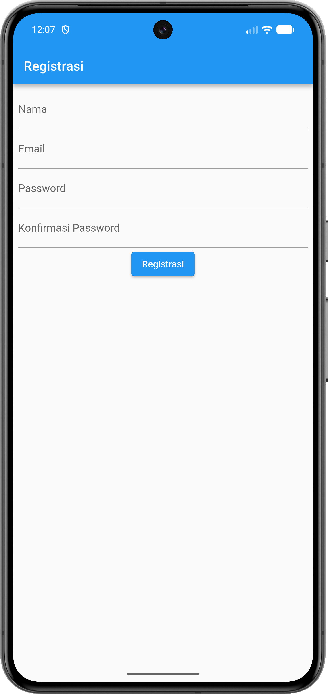
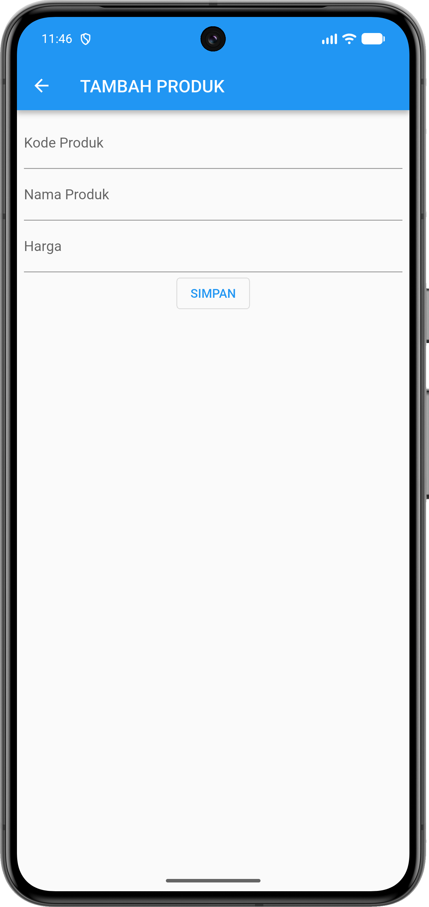
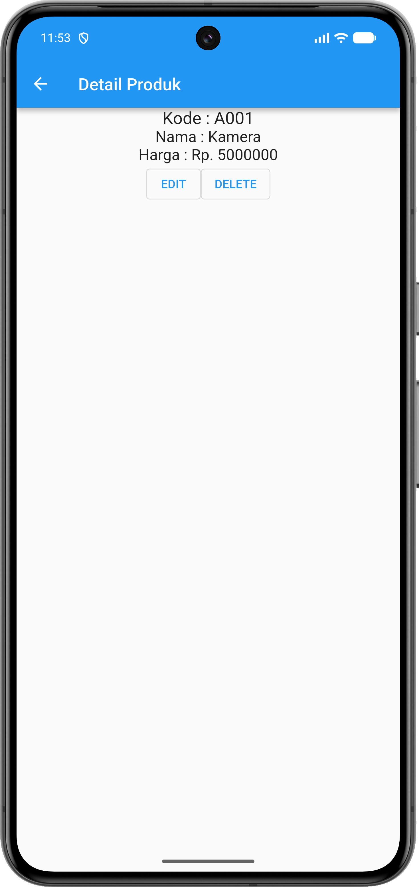
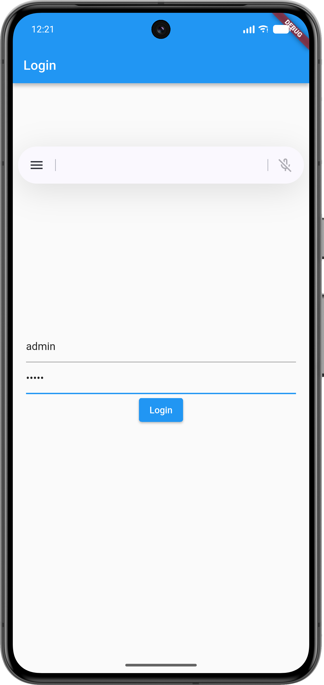
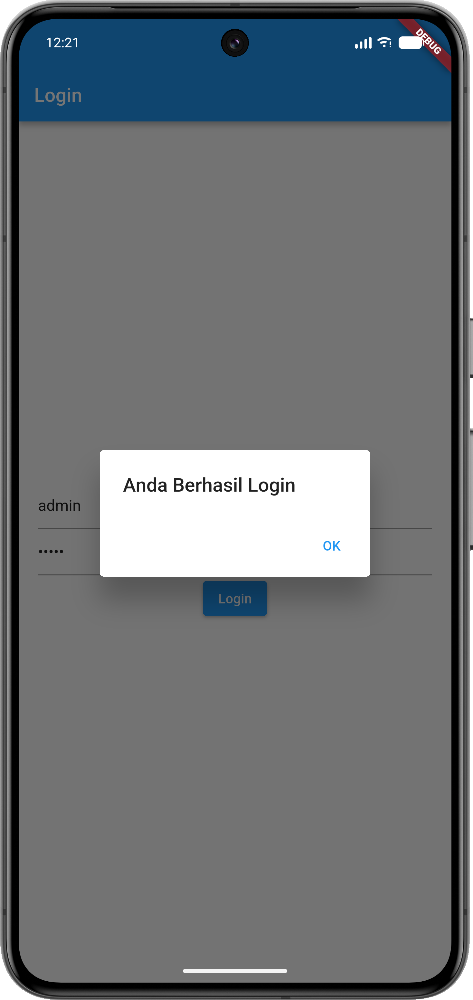
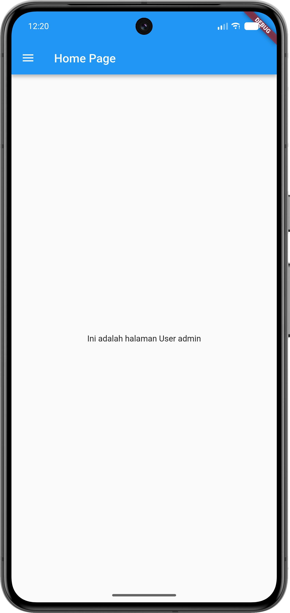

# Pemrograman Mobile — Framework Flutter

Repository ini berisi kumpulan tugas dan modul praktikum **Pemrograman Mobile Flutter**, yang mencakup perancangan antarmuka, routing, pengelolaan state, penyimpanan lokal, hingga integrasi arsitektur RESTful API CRUD.

---

## Daftar Modul Praktikum
1. [Modul 4: Operasi CRUD dengan API CodeIgniter 4 (Bagian 1 — Model & UI Toko Kita)](#modul-4-operasi-crud-dengan-api-codeigniter-4-bagian-1--model--ui-toko-kita)
2. [Modul 3: Routes, Side Menu, Login, dan Local Storage](#modul-3-routes-side-menu-login-dan-local-storage)
3. [Modul 2: Pengenalan Widget & Desain Framework Flutter](#modul-2-pengenalan-widget--desain-framework-flutter)

---

# Modul 4: Operasi CRUD dengan API CodeIgniter 4 (Bagian 1 — Model & UI Toko Kita)

Modul 4 Bagian 1 berfokus pada persiapan arsitektur RESTful API pada backend CodeIgniter 4 serta pembangunan fondasi aplikasi **Toko Kita** di Flutter yang mencakup pemetaan data model JSON dan perancangan antarmuka pengguna (UI) untuk modul autentikasi dan manajemen katalog produk.

### 1. Backend RESTful API (CodeIgniter 4 & MySQL)
Pada backend, dibuat basis data `toko_api` dengan tabel `member`, `member_token`, dan `produk`. Endpoint yang disediakan meliputi:
- **Registrasi (`POST /registrasi`)**: Mendaftarkan pengguna baru dengan enkripsi kata sandi `PASSWORD_DEFAULT`.
- **Login (`POST /login`)**: Verifikasi akun dan pembuatan token autentikasi acak (`auth_key`).
- **CRUD Produk (`/produk`)**:
  - `POST /produk` : Menambah data produk baru (*Create*).
  - `GET /produk` : Menampilkan seluruh daftar produk (*List/Read*).
  - `GET /produk/{id}` : Menampilkan detail satu produk berdasarkan ID (*Detail*).
  - `PUT /produk/{id}` : Memperbarui data produk (*Update*).
  - `DELETE /produk/{id}` : Menghapus data produk (*Delete*).

### 2. Perancangan Model Data Flutter (`lib/model/`)
Dibuat class model bertipe POJO (*Plain Old Java Object*) / Dart Class dengan metode deserialisasi `factory .fromJson` untuk memetakan respons JSON dari REST API:
- **`Login` (`lib/model/login.dart`)**: Memetakan status login, token, ID user, dan email user.
- **`Registrasi` (`lib/model/registrasi.dart`)**: Memetakan kode respons, status boolean, dan pesan registrasi.
- **`Produk` (`lib/model/produk.dart`)**: Memetakan properti produk (`id`, `kodeProduk`, `namaProduk`, dan `hargaProduk`).

### 3. Perancangan Halaman Antarmuka UI (`lib/ui/`)
- **Halaman Registrasi (`lib/ui/registrasi_page.dart`)**:
  Form pendaftaran dengan validasi ketat:
  - Nama minimal 3 karakter.
  - Validasi pola format email menggunakan RegExp.
  - Password minimal 6 karakter.
  - Konfirmasi password yang harus sama persis dengan field password.
- **Halaman Login (`lib/ui/login_page.dart`)**:
  Form login email dan password dengan navigasi tautan teks `Registrasi` di bawah tombol login untuk berpindah ke `RegistrasiPage`.
- **Halaman List Produk (`lib/ui/produk_page.dart`)**:
  Menampilkan daftar katalog produk (Kamera, Kulkas, Mesin Cuci) menggunakan `Card` dan `ListTile`, tombol `+` di kanan atas AppBar untuk menuju form penambahan produk, serta `Drawer` berisi opsi Logout.
- **Halaman Form Tambah & Ubah Produk (`lib/ui/produk_form.dart`)**:
  Form dinamis dengan logika `isUpdate()`:
  - Jika objek `produk` kosong (`null`), judul menjadi **"TAMBAH PRODUK"** dengan tombol **SIMPAN**.
  - Jika objek `produk` ada, judul menjadi **"UBAH PRODUK"** dengan tombol **UBAH** dan isian form otomatis terisi data produk terpilih.
- **Halaman Detail Produk (`lib/ui/produk_detail.dart`)**:
  Menampilkan data lengkap produk, tombol **EDIT** untuk mengubah data pada `ProdukForm`, dan tombol **DELETE** yang menampilkan pop-up `AlertDialog` konfirmasi sebelum menghapus data.

---

## Tampilan Hasil Program Modul 4 (Screenshots)

| 1. Halaman Registrasi (`RegistrasiPage`) | 2. Halaman Login (`LoginPage`) |
| :---: | :---: |
|  |  |
| Form registrasi lengkap dengan validasi nama, email, password, dan konfirmasi password. | Form login dengan link navigasi registrasi di bagian bawah. |

| 3. Halaman List Produk (`ProdukPage`) | 4. Halaman Tambah Produk (`ProdukForm`) |
| :---: | :---: |
|  |  |
| Katalog produk dengan tombol `+` pada AppBar dan menu samping Drawer. | Form penambahan produk baru dengan tombol **SIMPAN**. |

| 5. Halaman Detail Produk (`ProdukDetail`) | 6. Halaman Ubah Produk (`ProdukForm`) |
| :---: | :---: |
|  |  |
| Tampilan detail produk disertai tombol **EDIT** dan tombol **DELETE** konfirmasi. | Form edit yang otomatis memuat data produk dengan tombol **UBAH**. |

---

# Modul 3: Routes, Side Menu, Login, dan Local Storage

Modul 3 mendemonstrasikan sistem autentikasi login lokal, penyimpanan sesi dengan `SharedPreferences`, serta navigasi antarhalaman menggunakan `Navigator` dan `Drawer` (Side Menu).

### Fitur Utama:
- **Autentikasi Login (`LoginPage`)**: Validasi input username dan password (`admin` / `admin`).
- **Local Storage (`SharedPreferences`)**: Menyimpan username ke penyimpanan lokal perangkat dan memanggilnya kembali pada `HomePage`.
- **Side Menu / Drawer (`Sidemenu`)**: Menu navigasi samping untuk berpindah antara halaman **Home** dan **About**.

### Tampilan Hasil Program Modul 3:

| Form Login | Dialog Berhasil Login | Home Page | Side Menu (Drawer) |
| :---: | :---: | :---: | :---: |
|  |  |  |  |

---

# Modul 2: Pengenalan Widget & Desain Framework Flutter

Modul 2 mencakup pembelajaran widget dasar Flutter:
- `StatelessWidget` dan `StatefulWidget`
- `Text`, `Center`, `Scaffold`, dan `AppBar` pada [hello_world.dart](file:///D:/panduan%20praktikum/belajarflutter/lib/hello_world.dart)
- Penataan elemen tata letak vertikal pada [column_widget.dart](file:///D:/panduan%20praktikum/belajarflutter/lib/column_widget.dart)
- Penataan elemen tata letak horizontal pada [row_widget.dart](file:///D:/panduan%20praktikum/belajarflutter/lib/row_widget.dart)

---

## Struktur Direktori Proyek

```text
belajarflutter/
├── img/                                 # Kumpulan screenshot dokumentasi aplikasi
│   ├── Screenshot_20261105_122030.png   # (Modul 3) Home Page
│   ├── Screenshot_20261105_122049.png   # (Modul 3) Side Menu Drawer
│   ├── Screenshot_20261105_122109.png   # (Modul 3) Alert Dialog Login
│   ├── Screenshot_20261105_122128.png   # (Modul 3) Form Login
│   ├── Screenshot_20261117_234547.png   # (Modul 4) List Produk
│   ├── Screenshot_20261117_234607.png   # (Modul 4) Tambah Produk Form
│   ├── Screenshot_20261117_234650.png   # (Modul 4) Ubah Produk Form
│   ├── Screenshot_20261117_235303.png   # (Modul 4) Detail Produk
│   ├── Screenshot_20261118_000450.png   # (Modul 4) Login Page Toko Kita
│   └── Screenshot_20261118_000733.png   # (Modul 4) Registrasi Page Toko Kita
├── lib/
│   ├── main.dart                        # Titik masuk utama aplikasi Toko Kita
│   ├── model/                           # Model data respons API (Modul 4)
│   │   ├── login.dart                   # Model Login
│   │   ├── registrasi.dart              # Model Registrasi
│   │   └── produk.dart                  # Model Produk
│   ├── ui/                              # Halaman antarmuka aplikasi (Modul 4)
│   │   ├── login_page.dart              # Halaman Login
│   │   ├── registrasi_page.dart         # Halaman Registrasi
│   │   ├── produk_page.dart             # Halaman List Produk
│   │   ├── produk_form.dart             # Halaman Tambah / Ubah Produk
│   │   └── produk_detail.dart           # Halaman Detail Produk
│   ├── home_page.dart                   # (Modul 3) Halaman Home
│   ├── sidemenu.dart                    # (Modul 3) Widget Drawer
│   ├── about_page.dart                  # (Modul 3) Halaman About
│   ├── hello_world.dart                 # (Modul 2) Widget Hello World
│   ├── column_widget.dart               # (Modul 2) Widget Column
│   └── row_widget.dart                  # (Modul 2) Widget Row
├── test/
│   └── widget_test.dart                 # Unit & widget testing otomatis
└── pubspec.yaml                         # Konfigurasi dependensi proyek
```

---

## Cara Menjalankan Proyek

1. Pastikan Flutter SDK dan emulator Android sudah aktif.
2. Unduh paket dependensi:
   ```bash
   flutter pub get
   ```
3. Jalankan pengujian unit/widget:
   ```bash
   flutter test
   ```
4. Jalankan aplikasi:
   ```bash
   flutter run
   ```
