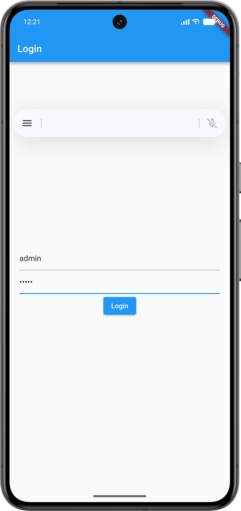
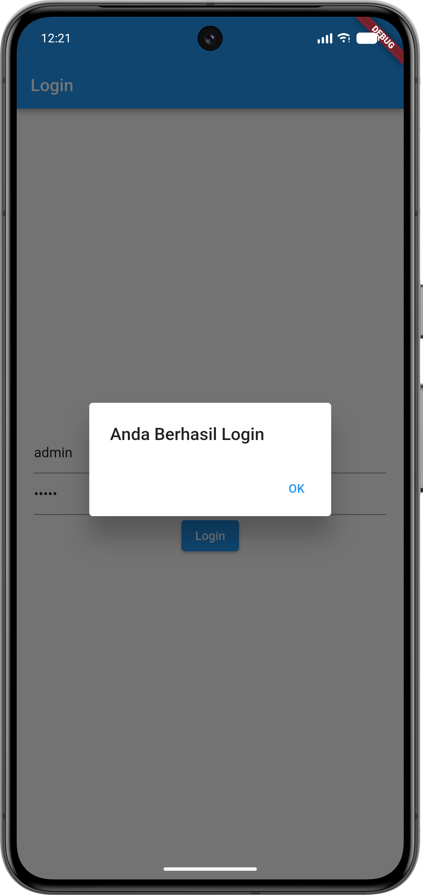
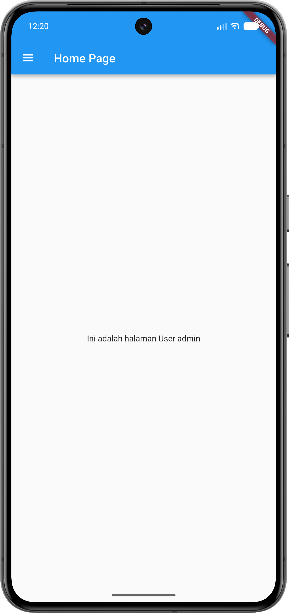
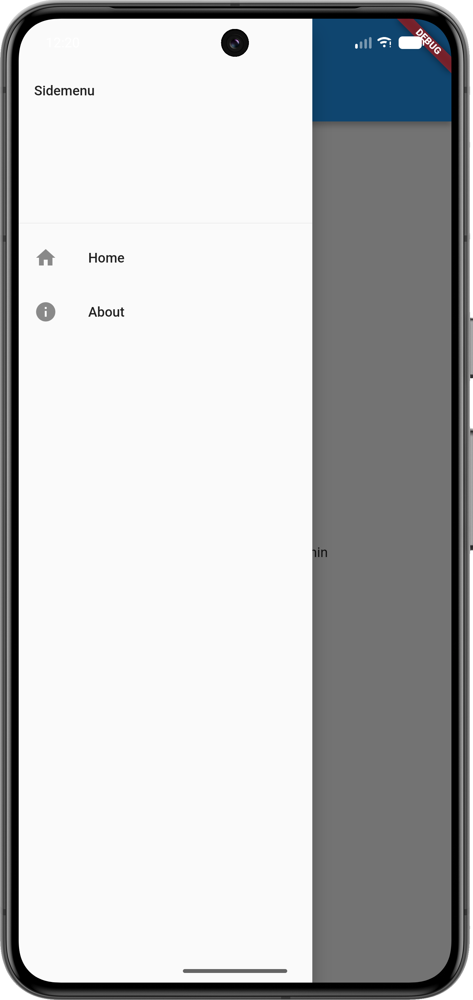

# Modul 3 Pemrograman Mobile — Routes, Side Menu, Login, dan Local Storage pada Flutter

Aplikasi **Belajar Flutter (`belajarflutter`)** ini merupakan implementasi dari **Modul 3 Pemrograman Mobile: Routes, Side Menu, Login, dan Local Storage Framework Flutter** (serta komponen dasar widget pada Modul 2). Proyek ini mendemonstrasikan cara membuat sistem autentikasi login sederhana, menyimpan data sesi pengguna ke dalam penyimpanan lokal (*Local Storage*) menggunakan `SharedPreferences`, serta melakukan navigasi antarhalaman (*Routes*) menggunakan `Navigator` dan menu samping (`Drawer` / *Side Menu*).

---

## Daftar Isi
1. [Fitur Utama](#fitur-utama)
2. [Struktur File Proyek](#struktur-file-proyek)
3. [Penjelasan Kode dan Alur Program](#penjelasan-kode-dan-alur-program)
   - [1. Konfigurasi Dependencies (`pubspec.yaml`)](#1-konfigurasi-dependencies-pubspecyaml)
   - [2. Halaman Login (`lib/login_page.dart`)](#2-halaman-login-liblogin_pagedart)
   - [3. Konfigurasi Halaman Utama Aplikasi (`lib/main.dart`)](#3-konfigurasi-halaman-utama-aplikasi-libmaindart)
   - [4. Halaman Home (`lib/home_page.dart`)](#4-halaman-home-libhome_pagedart)
   - [5. Halaman Side Menu / Drawer (`lib/sidemenu.dart`)](#5-halaman-side-menu--drawer-libsidemenudart)
   - [6. Halaman About (`lib/about_page.dart`)](#6-halaman-about-libabout_pagedart)
4. [Tampilan Hasil Program (Screenshots)](#tampilan-hasil-program-screenshots)
5. [Cara Menjalankan Proyek](#cara-menjalankan-proyek)

---

## Fitur Utama
- **Autentikasi Login (`LoginPage`)**: Validasi input *username* dan *password* (`admin` / `admin`) disertai notifikasi pop-up (`AlertDialog`).
- **Penyimpanan Lokal / Local Storage (`SharedPreferences`)**: Menyimpan *username* yang berhasil login ke memori lokal perangkat dan memuatnya kembali pada halaman utama.
- **Navigasi Halaman (*Routes*)**: Perpindahan halaman menggunakan `Navigator.push` dan `MaterialPageRoute`.
- **Side Menu (`Drawer`)**: Menu navigasi samping yang memudahkan pengguna berpindah antara halaman **Home** dan **About**.

---

## Struktur File Proyek

```text
belajarflutter/
├── img/
│   ├── Screenshot_20261105_122030.png   # Tampilan Home Page
│   ├── Screenshot_20261105_122049.png   # Tampilan Side Menu (Drawer)
│   ├── Screenshot_20261105_122109.png   # Tampilan Dialog Berhasil Login
│   └── Screenshot_20261105_122128.png   # Tampilan Form Login
├── lib/
│   ├── main.dart                        # Entry point aplikasi (mengarahkan ke LoginPage)
│   ├── login_page.dart                  # Halaman Login & penyimpanan SharedPreferences
│   ├── home_page.dart                   # Halaman Home & pembacaan SharedPreferences
│   ├── sidemenu.dart                    # Widget Drawer (Side Menu) untuk navigasi
│   ├── about_page.dart                  # Halaman About
│   ├── hello_world.dart                 # (Modul 2) Widget Hello World
│   ├── column_widget.dart               # (Modul 2) Widget Column
│   ├── row_widget.dart                  # (Modul 2) Widget Row
│   └── ui/                              # (Modul 2) Form, Detail, & ListView Produk
│       ├── produk_form.dart
│       ├── produk_detail.dart
│       └── produk_page.dart
└── pubspec.yaml                         # Konfigurasi dependencies (shared_preferences)
```

---

## Penjelasan Kode dan Alur Program

### 1. Konfigurasi Dependencies (`pubspec.yaml`)
Untuk menggunakan fitur *Local Storage* pada Flutter, ditambahkan package `shared_preferences` pada bagian `dependencies` di file `pubspec.yaml`:

```yaml
dependencies:
  flutter:
    sdk: flutter
  cupertino_icons: ^1.0.8
  shared_preferences: 2.3.5
```

Package `shared_preferences` berfungsi menyimpan data sederhana berbentuk *key-value* (seperti `username`) secara persisten di dalam perangkat.

---

### 2. Halaman Login (`lib/login_page.dart`)
File `login_page.dart` menggunakan `StatefulWidget` (`LoginPage` dan `_LoginPageState`) yang memiliki dua `TextEditingController`, yaitu `_usernameController` dan `_passwordController`.

Di dalam `_LoginPageState` terdapat beberapa fungsi utama:
- **`_saveUsername()`**: Menginisialisasi `SharedPreferences.getInstance()` secara *asynchronous* (`async`/`await`), lalu menyimpan teks dari `_usernameController` ke dalam *key* `'username'` menggunakan `prefs.setString('username', _usernameController.text)`.
- **`_showInput(namacontroller, placeholder, isPassword)`**: Fungsi pembuat widget `TextField` yang menerima parameter controller, teks petunjuk (`hintText`), serta status penyembunyian karakter (`obscureText: true` untuk kolom password).
- **`_showDialog(pesan, alamat)`**: Menampilkan pop-up `AlertDialog` berisi status login. Ketika tombol **OK** ditekan, aplikasi akan berpindah ke halaman tujuan (`alamat`) menggunakan `Navigator.push` dan `MaterialPageRoute`.
- **Logika Tombol Login (`ElevatedButton`)**:
  - Jika `_usernameController.text == 'admin'` dan `_passwordController.text == 'admin'`, maka fungsi `_saveUsername()` dijalankan dan muncul dialog `"Anda Berhasil Login"` yang mengarahkan pengguna ke `HomePage()`.
  - Jika salah, muncul dialog `"Username dan Password Salah"` yang mengembalikan pengguna ke `LoginPage()`.

---

### 3. Konfigurasi Halaman Utama Aplikasi (`lib/main.dart`)
File `main.dart` merupakan titik awal (*entry point*) aplikasi yang menjalankan `MyApp`. Properti `home:` pada `MaterialApp` diarahkan langsung ke `LoginPage()` agar pengguna terlebih dahulu melakukan login saat aplikasi dibuka:

```dart
class MyApp extends StatelessWidget {
  const MyApp({super.key});

  @override
  Widget build(BuildContext context) {
    return MaterialApp(
      title: 'Flutter Menu',
      theme: ThemeData(
        useMaterial3: false,
        primarySwatch: Colors.blue,
      ),
      home: const LoginPage(),
    );
  }
}
```

---

### 4. Halaman Home (`lib/home_page.dart`)
File `home_page.dart` menggunakan `StatefulWidget` (`HomePage`) untuk menampilkan halaman utama setelah pengguna berhasil login:
- **`_loadUsername()`**: Membaca kembali data yang tersimpan di *Local Storage* menggunakan `prefs.getString('username')`, menyimpannya ke variabel `namauser`, lalu memanggil `setState()` agar antarmuka diperbarui.
- **`Scaffold`**: Menampilkan `AppBar` dengan judul `'Home Page'`, teks `'Ini adalah halaman User $namauser'` di bagian tengah layar (`Center`), serta komponen menu samping pada properti `drawer: const Sidemenu()`.

---

### 5. Halaman Side Menu / Drawer (`lib/sidemenu.dart`)
File `sidemenu.dart` merupakan `StatelessWidget` (`Sidemenu`) yang mengembalikan widget `Drawer` berisi `ListView` dengan komponen:
- **`DrawerHeader`**: Menampilkan judul header `'Sidemenu'`.
- **`ListTile` Home (`Icons.home`)**: Menavigasikan pengguna ke halaman `HomePage()` menggunakan `Navigator.push` dan `MaterialPageRoute`.
- **`ListTile` About (`Icons.info`)**: Menavigasikan pengguna ke halaman `AboutPage()` menggunakan `Navigator.push` dan `MaterialPageRoute`.

---

### 6. Halaman About (`lib/about_page.dart`)
File `about_page.dart` merupakan `StatelessWidget` (`AboutPage`) yang menampilkan `AppBar` bertuliskan `'About Page'`, konten utama `'Ini adalah halaman About'` di tengah layar, serta menyertakan `drawer: const Sidemenu()` sehingga pengguna tetap dapat membuka menu samping dari halaman About.

---

## Tampilan Hasil Program (Screenshots)

| 1. Halaman Form Login (`LoginPage`) | 2. Dialog Berhasil Login (`AlertDialog`) |
| :---: | :---: |
|  |  |
| Pengguna memasukkan *username* `admin` dan *password* `admin` pada halaman Login. | Pop-up konfirmasi `"Anda Berhasil Login"` muncul sebelum dialihkan ke `HomePage`. |

| 3. Halaman Utama (`HomePage`) | 4. Navigasi Side Menu (`Sidemenu`) |
| :---: | :---: |
|  |  |
| Menampilkan `"Ini adalah halaman User admin"` yang diambil dari `SharedPreferences`. | Menu samping (`Drawer`) dengan opsi navigasi rute ke halaman **Home** dan **About**. |

---

## Cara Menjalankan Proyek

1. Pastikan Flutter SDK dan emulator Android / perangkat sudah aktif.
2. Unduh seluruh dependencies proyek:
   ```bash
   flutter pub get
   ```
3. Jalankan aplikasi:
   ```bash
   flutter run
   ```
4. Gunakan kredensial berikut untuk login:
   - **Username:** `admin`
   - **Password:** `admin`
