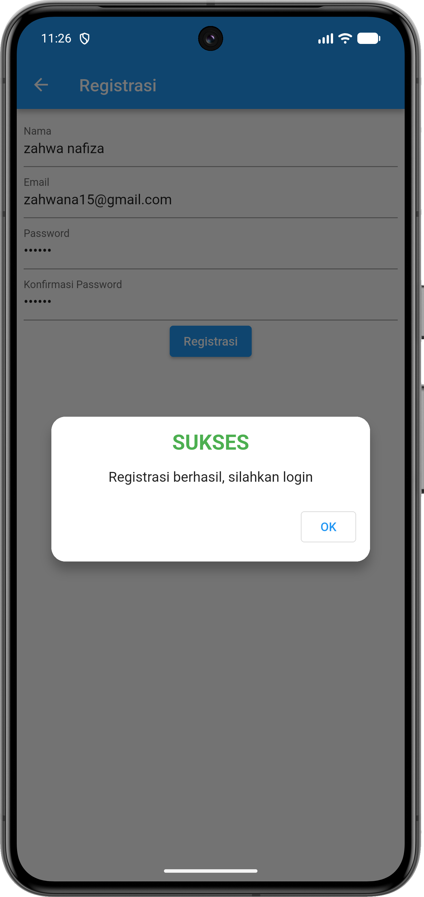
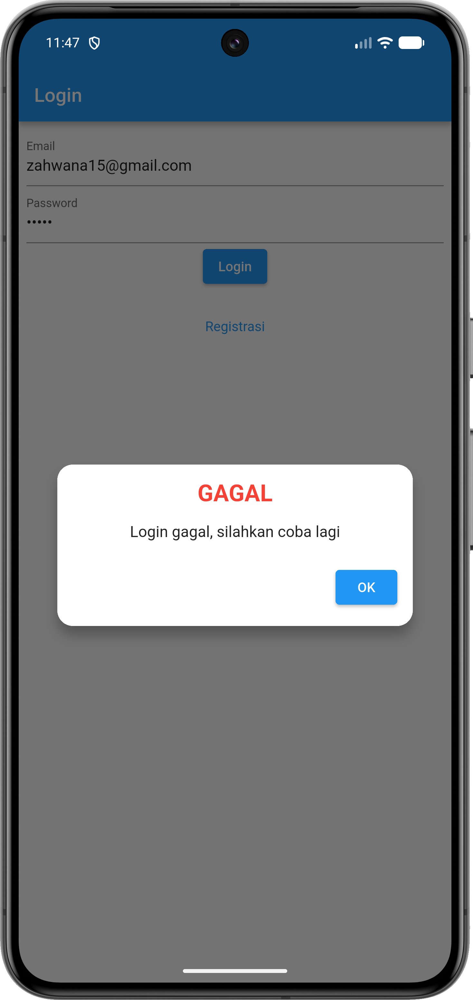
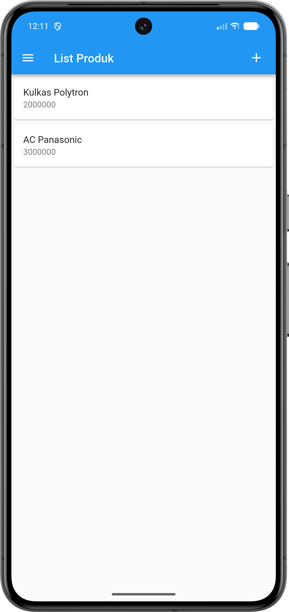
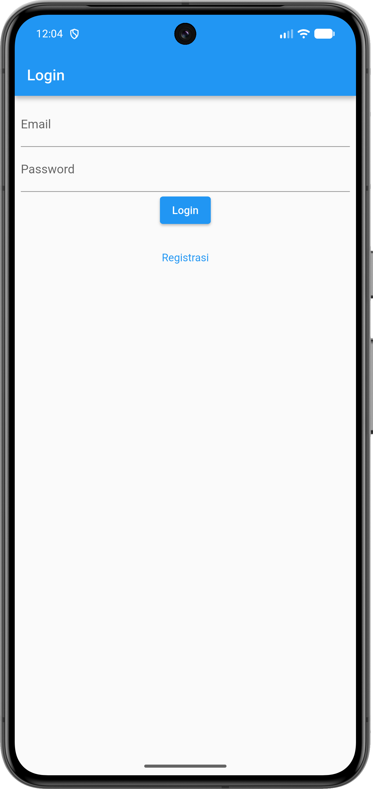
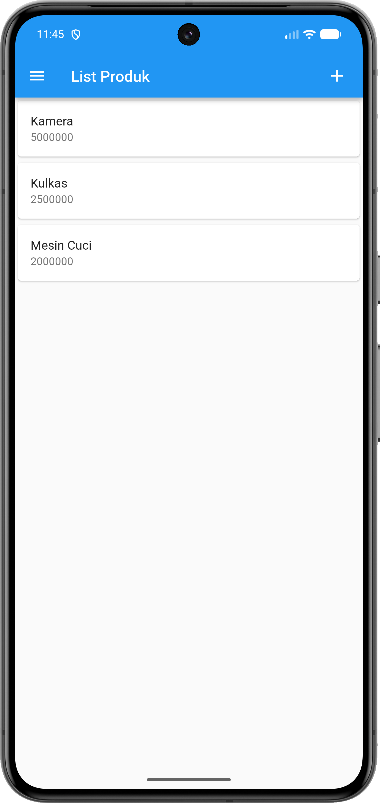
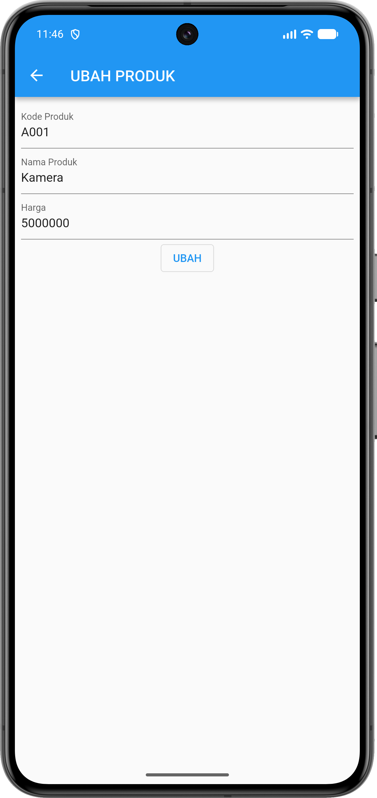
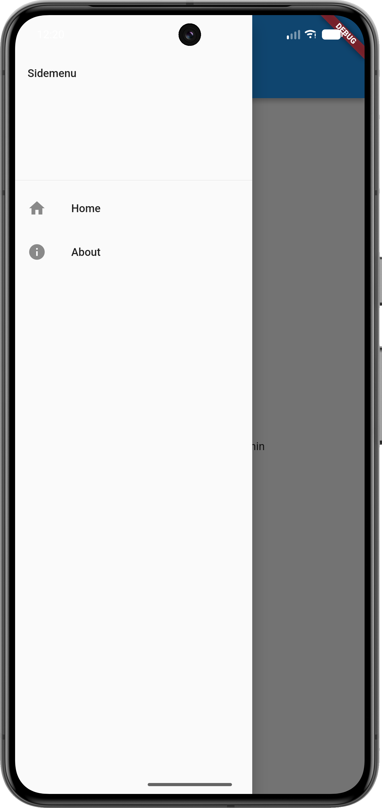

# Pemrograman Mobile — Framework Flutter

Repository ini berisi kumpulan tugas dan modul praktikum **Pemrograman Mobile Flutter**, yang mencakup perancangan antarmuka, routing, pengelolaan state, penyimpanan lokal, hingga integrasi penuh **Operasi CRUD dengan RESTful API CodeIgniter 4 & MySQL**.

---

## Daftar Modul Praktikum
1. [Modul 5: Operasi CRUD dengan API CodeIgniter 4 (Bagian 2 — Integrasi REST API, BLoC, Helpers & Dialog)](#modul-5-operasi-crud-dengan-api-codeigniter-4-bagian-2--integrasi-rest-api-bloc-helpers--dialog)
2. [Modul 4: Operasi CRUD dengan API CodeIgniter 4 (Bagian 1 — Model & UI Toko Kita)](#modul-4-operasi-crud-dengan-api-codeigniter-4-bagian-1--model--ui-toko-kita)
3. [Modul 3: Routes, Side Menu, Login, dan Local Storage](#modul-3-routes-side-menu-login-dan-local-storage)
4. [Modul 2: Pengenalan Widget & Desain Framework Flutter](#modul-2-pengenalan-widget--desain-framework-flutter)

---

# Modul 5: Operasi CRUD dengan API CodeIgniter 4 (Bagian 2 — Integrasi REST API, BLoC, Helpers & Dialog)

Modul 5 (lanjutan dari Modul 4) menghubungkan seluruh antarmuka aplikasi **Toko Kita** dengan backend **RESTful API CodeIgniter 4 (`toko-api`)** dan database **MySQL (`toko_api`)** menggunakan arsitektur terstruktur: **Helpers**, **BLoC**, **Common Widgets**, dan **State Persistence**.

### 1. Konfigurasi Dependencies & Jaringan (`pubspec.yaml` & `AndroidManifest.xml`)
- Menambahkan package **`http`** untuk komunikasi HTTP (`GET`, `POST`, `DELETE`) ke REST API dan **`shared_preferences`** untuk menyimpan sesi login (`token` & `userID`).
- Menambahkan izin `android.permission.INTERNET` dan `android:usesCleartextTraffic="true"` pada `android/app/src/main/AndroidManifest.xml` agar emulator Android dapat mengakses endpoint HTTP lokal (`http://10.0.2.2/toko-api/public`).

### 2. Layer Helpers (`lib/helpers/`)
- **`user_info.dart` (`UserInfo`)**: Mengelola penyimpanan lokal menggunakan `SharedPreferences` untuk menyimpan/mengambil `token` (`setToken`, `getToken`), `userID` (`setUserID`, `getUserID`), serta menghapus sesi saat `logout()`.
- **`app_exception.dart` (`AppException`)**: Menangani error komunikasi API secara terstruktur melalui class exception khusus (`FetchDataException`, `BadRequestException`, `UnauthorisedException`, `UnprocessableEntityException`, dan `InvalidInputException`).
- **`api.dart` (`Api`)**: Wrapper HTTP client untuk request `post`, `get`, dan `delete` dengan header `Authorization: Bearer $token`, penanganan `SocketException`, dan validasi HTTP status code lewat `_returnResponse()`.
- **`api_url.dart` (`ApiUrl`)**: Menyimpan daftar URL endpoint REST API (`baseUrl = 'http://10.0.2.2/toko-api/public'`), meliputi `registrasi`, `login`, `listProduk`, `createProduk`, `updateProduk(id)`, `showProduk(id)`, dan `deleteProduk(id)`.

### 3. Layer BLoC / Controller (`lib/bloc/`)
- **`registrasi_bloc.dart` (`RegistrasiBloc`)**: Mengirim data registrasi (`nama`, `email`, `password`) ke `POST /registrasi` dan memetakan respons JSON ke model `Registrasi`.
- **`login_bloc.dart` (`LoginBloc`)**: Mengirim kredensial (`email`, `password`) ke `POST /login` dan mengembalikan objek `Login` berisi `token` dan `userID`.
- **`logout_bloc.dart` (`LogoutBloc`)**: Memanggil `UserInfo().logout()` untuk membersihkan sesi pada `SharedPreferences`.
- **`produk_bloc.dart` (`ProdukBloc`)**:
  - `getProduks()` : Mengambil daftar produk dari `GET /produk`.
  - `addProduk()` : Menambah produk baru ke `POST /produk`.
  - `updateProduk()` : Mengubah data produk ke `POST /produk/{id}/update`.
  - `deleteProduk()` : Menghapus data produk ke `DELETE /produk/{id}`.

### 4. Common Dialog Widgets (`lib/widget/`)
- **`success_dialog.dart` (`SuccessDialog`)**: Dialog custom berwarna hijau bertuliskan **"SUKSES"** untuk memberi umpan balik saat operasi berhasil.
- **`warning_dialog.dart` (`WarningDialog`)**: Dialog custom berwarna merah bertuliskan **"GAGAL"** saat validasi server atau koneksi mengalami kegagalan.

### 5. Integrasi Fungsionalitas ke Halaman UI & `main.dart`
- **`lib/main.dart`**: `MyApp` diubah menjadi `StatefulWidget` yang memanggil `isLogin()` di `initState()` untuk mengecek `UserInfo().getToken()`. Jika token tersimpan, pengguna langsung diarahkan ke `ProdukPage`; jika belum, diarahkan ke `LoginPage`.
- **`lib/ui/registrasi_page.dart`**: Fungsi `_submit()` memanggil `RegistrasiBloc.registrasi()`, menampilkan `SuccessDialog("Registrasi berhasil, silahkan login")` jika berhasil, atau `WarningDialog` jika gagal.
- **`lib/ui/login_page.dart`**: Fungsi `_submit()` memanggil `LoginBloc.login()`, menyimpan `token` serta `userID` ke `UserInfo` dan membuka `ProdukPage` jika berhasil (`code == 200`), atau menampilkan `WarningDialog("Login gagal, silahkan coba lagi")` jika email/password salah.
- **`lib/ui/produk_page.dart`**: Menggunakan `FutureBuilder<List<Produk>>` untuk memuat dan merender daftar produk langsung dari REST API (`ProdukBloc.getProduks()`), serta menghubungkan menu **Logout** di `Drawer` ke `LogoutBloc.logout()`.
- **`lib/ui/produk_form.dart`**: Menghubungkan tombol submit ke fungsi `simpan()` (`ProdukBloc.addProduk`) untuk mode tambah produk dan fungsi `ubah()` (`ProdukBloc.updateProduk`) untuk mode ubah produk.
- **`lib/ui/produk_detail.dart`**: Menghubungkan tombol konfirmasi **"Ya"** pada dialog hapus (`confirmHapus()`) ke `ProdukBloc.deleteProduk(id: widget.produk!.id)` untuk menghapus produk di database melalui API.

---

## Tampilan Hasil Program Modul 5 (Screenshots)

| 1. Registrasi Berhasil (`SuccessDialog`) | 2. Validasi Login Gagal (`WarningDialog`) | 3. List Produk dari REST API (`ProdukPage`) |
| :---: | :---: | :---: |
|  |  |  |
| Dialog **SUKSES** setelah data registrasi berhasil disimpan ke database MySQL melalui API. | Dialog **GAGAL** muncul ketika kredensial login salah atau ditolak oleh server API. | Daftar produk (**Kulkas Polytron**, **AC Panasonic**) dimuat dinamis dari API menggunakan `FutureBuilder`. |

---

# Modul 4: Operasi CRUD dengan API CodeIgniter 4 (Bagian 1 — Model & UI Toko Kita)

Modul 4 Bagian 1 berfokus pada persiapan backend CodeIgniter 4 (`toko-api`), pembuatan database MySQL `toko_api` (`member`, `member_token`, `produk`), pemetaan model JSON (`Login`, `Registrasi`, `Produk`), serta perancangan tampilan UI awal aplikasi **Toko Kita**.

### Tampilan Hasil Program Modul 4 (Screenshots):

| 1. Halaman Registrasi (`RegistrasiPage`) | 2. Halaman Login (`LoginPage`) | 3. Halaman List Produk (`ProdukPage`) |
| :---: | :---: | :---: |
|  |  |  |

| 4. Tambah Produk (`ProdukForm`) | 5. Detail Produk (`ProdukDetail`) | 6. Ubah Produk (`ProdukForm`) |
| :---: | :---: | :---: |
|  |  |  |

---

# Modul 3: Routes, Side Menu, Login, dan Local Storage

Modul 3 mendemonstrasikan sistem autentikasi login lokal, penyimpanan sesi dengan `SharedPreferences`, serta navigasi antarhalaman menggunakan `Navigator` dan `Drawer` (Side Menu).

### Tampilan Hasil Program Modul 3:

| Form Login | Dialog Berhasil Login | Home Page | Side Menu (Drawer) |
| :---: | :---: | :---: | :---: |
|  |  |  |  |

---

# Modul 2: Pengenalan Widget & Desain Framework Flutter

Modul 2 mencakup pembelajaran widget dasar Flutter:
- `StatelessWidget` dan `StatefulWidget`
- `Text`, `Center`, `Scaffold`, dan `AppBar` pada [`lib/hello_world.dart`](lib/hello_world.dart)
- Penataan elemen tata letak vertikal pada [`lib/column_widget.dart`](lib/column_widget.dart)
- Penataan elemen tata letak horizontal pada [`lib/row_widget.dart`](lib/row_widget.dart)

---

## Struktur Direktori Proyek

```text
belajarflutter/
├── android/
│   └── app/src/main/AndroidManifest.xml  # Izin INTERNET & usesCleartextTraffic
├── img/                                  # Kumpulan screenshot dokumentasi aplikasi
│   ├── Screenshot_20261105_122030.png    # (Modul 3) Home Page
│   ├── Screenshot_20261105_122049.png    # (Modul 3) Side Menu Drawer
│   ├── Screenshot_20261105_122109.png    # (Modul 3) Alert Dialog Login
│   ├── Screenshot_20261105_122128.png    # (Modul 3) Form Login
│   ├── Screenshot_20261117_234547.png    # (Modul 4) List Produk
│   ├── Screenshot_20261117_234607.png    # (Modul 4) Tambah Produk Form
│   ├── Screenshot_20261117_234650.png    # (Modul 4) Ubah Produk Form
│   ├── Screenshot_20261117_235303.png    # (Modul 4) Detail Produk
│   ├── Screenshot_20261118_000450.png    # (Modul 4) Login Page Toko Kita
│   ├── Screenshot_20261118_000733.png    # (Modul 4) Registrasi Page Toko Kita
│   ├── Screenshot_20261118_112642.png    # (Modul 5) Dialog Sukses Registrasi
│   ├── Screenshot_20261118_114747.png    # (Modul 5) Dialog Gagal Login
│   └── Screenshot_20261118_121136.png    # (Modul 5) List Produk dari REST API
├── lib/
│   ├── main.dart                         # Entry point & pengecekan sesi token login
│   ├── bloc/                             # Logic & penghubung ke REST API (Modul 5)
│   │   ├── login_bloc.dart
│   │   ├── logout_bloc.dart
│   │   ├── produk_bloc.dart
│   │   └── registrasi_bloc.dart
│   ├── helpers/                          # Utilitas HTTP, URL API, Exception & Token (Modul 5)
│   │   ├── api.dart
│   │   ├── api_url.dart
│   │   ├── app_exception.dart
│   │   └── user_info.dart
│   ├── model/                            # Model data respons JSON API (Modul 4)
│   │   ├── login.dart
│   │   ├── produk.dart
│   │   └── registrasi.dart
│   ├── ui/                               # Halaman antarmuka aplikasi Toko Kita
│   │   ├── login_page.dart
│   │   ├── produk_detail.dart
│   │   ├── produk_form.dart
│   │   ├── produk_page.dart
│   │   └── registrasi_page.dart
│   ├── widget/                           # Komponen Dialog Sukses & Gagal (Modul 5)
│   │   ├── success_dialog.dart
│   │   └── warning_dialog.dart
│   ├── home_page.dart                    # (Modul 3) Halaman Home
│   ├── sidemenu.dart                     # (Modul 3) Widget Drawer
│   ├── about_page.dart                   # (Modul 3) Halaman About
│   ├── hello_world.dart                  # (Modul 2) Widget Hello World
│   ├── column_widget.dart                # (Modul 2) Widget Column
│   └── row_widget.dart                   # (Modul 2) Widget Row
├── test/
│   └── widget_test.dart                  # Unit & widget testing otomatis
└── pubspec.yaml                          # Konfigurasi dependensi (http, shared_preferences)
```

---

## Cara Menjalankan Proyek

1. Pastikan **Apache** dan **MySQL** di XAMPP sudah aktif (*Start*), database `toko_api` tersedia, serta proyek CodeIgniter `toko-api` berada di `htdocs/toko-api`.
2. Pastikan Flutter SDK dan emulator Android sudah aktif.
3. Unduh paket dependensi:
   ```bash
   flutter pub get
   ```
4. Jalankan pengujian unit/widget:
   ```bash
   flutter test
   ```
5. Jalankan aplikasi:
   ```bash
   flutter run
   ```
